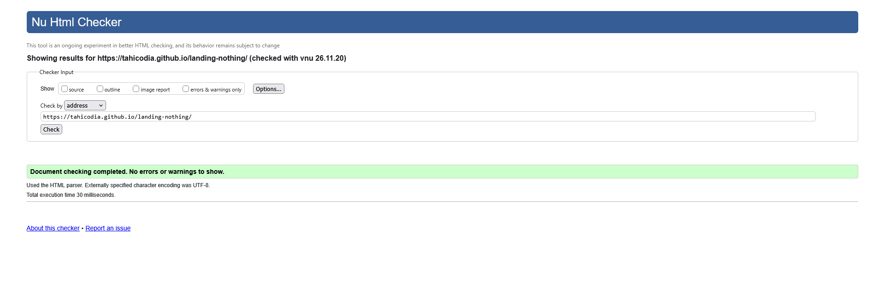
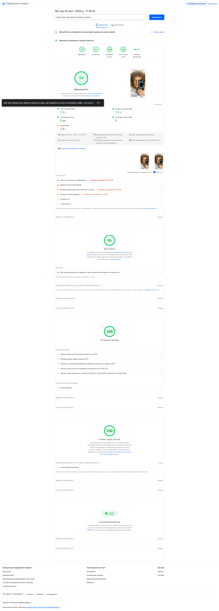
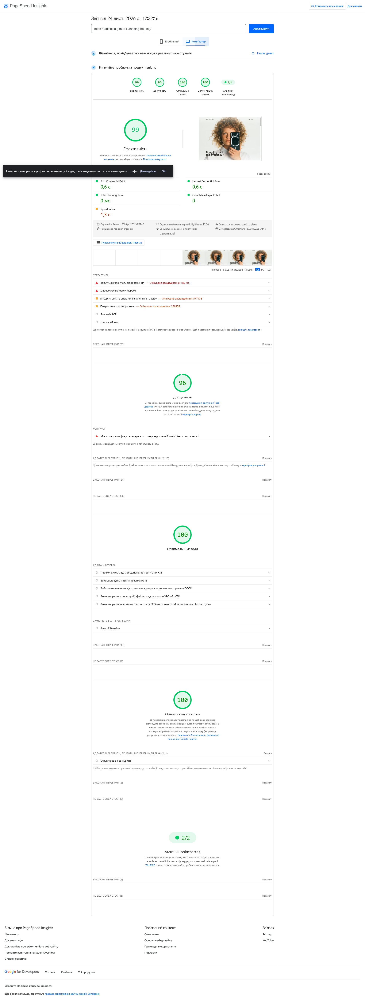

# Nothing — landing

Лендінг бренду Nothing за макетом Figma (варіант 2). Стек: Vite, Pug, SCSS, PostCSS (Autoprefixer, Browserslist), sharp. Методологія: BEM + ITCSS. Без JavaScript.

- Макет: [Figma](https://www.figma.com/design/xIVUXiPZ3hdpEFiIC0qbTL)
- Демо: <https://tahicodia.github.io/landing-nothing/>

## Команди

| Команда           | Що робить                                                         |
| ----------------- | ----------------------------------------------------------------- |
| `npm install`     | встановлює залежності                                             |
| `npm run dev`     | dev-сервер Vite                                                   |
| `npm run build`   | збірка в `dist/` (з `base` для GitHub Pages)                      |
| `npm run preview` | локальний перегляд збірки                                         |
| `npm run lint`    | перевірка SCSS Stylelint                                          |
| `npm run format`  | форматування Prettier                                             |
| `npm run images`  | генерує AVIF, WebP і JPEG із `images-src/` у `src/assets/images/` |

Публікація: GitHub Actions (`.github/workflows/deploy.yml`) збирає проєкт і викладає `dist/` на GitHub Pages після кожного пушу в `main`. Для цього в `vite.config.js` задано `base: '/landing-nothing/'` (лише для `build`).

## Дизайн-токени

### Сітка

| Фрейм | Колонки | Ширина колонки | Gutter | Поля                   |
| ----- | ------- | -------------- | ------ | ---------------------- |
| 320   | 2       | 130px          | 20px   | 20px                   |
| 744   | 6       | 80px           | 24px   | 72px                   |
| 1260  | 12      | 63px           | 24px   | 120px (контент 1020px) |

Брейкпоінти: `md` — 744px, `lg` — 1260px (mobile first).

### Кольори

| Токен            | Значення  | Де використовується              |
| ---------------- | --------- | -------------------------------- |
| `ink`            | `#292929` | текст, основна кнопка, іконки    |
| `ink-strong`     | `#191919` | значення в контактах             |
| `pressed`        | `#111111` | кнопка в стані pressed           |
| `white`          | `#ffffff` | фон сторінки, текст на кнопці    |
| `surface`        | `#f8f8fa` | поля форми, кнопка в стані hover |
| `surface-border` | `#f0f1f4` | рамка кнопки hover               |
| `field-hover`    | `#d5d7de` | рамка поля hover                 |
| `muted`          | `#7e7e83` | placeholder                      |
| `label`          | `#9393a3` | підписи в контактах              |
| `menu-bg`        | `#e5e6e8` | фон меню                         |

### Типографіка

| Роль               | Шрифт         | Вага | Розмір (320 / 744 / 1260)         | Висота рядка |
| ------------------ | ------------- | ---- | --------------------------------- | ------------ |
| h1                 | Space Grotesk | 700  | 36 / 48 / 56                      | 1            |
| h2                 | Space Grotesk | 700  | 32 / 40 / 48                      | 1            |
| h3 (категорії)     | Space Grotesk | 700  | 18 / 24 / 24                      | 1.4          |
| назва картки       | Space Grotesk | 700  | 18                                | 1.4          |
| кнопка             | Space Grotesk | 700  | 16                                | 27px         |
| посилання меню     | Space Grotesk | 700  | 22, letter-spacing 2px            | 1            |
| основний текст     | Space Mono    | 400  | 16                                | 1.4          |
| поля форми         | Space Mono    | 400  | 14                                | 1.4          |
| підпис у контактах | Space Grotesk | 400  | 14                                | 1.4          |
| телефон у шапці    | Inter         | 700  | 12, uppercase, letter-spacing 2px | 16px         |

### Інше

| Токен        | Значення                                                           |
| ------------ | ------------------------------------------------------------------ |
| Радіуси      | 4px (картки, зображення), 8px (кнопки, поля)                       |
| Відступи     | 8, 12, 16, 24, 32, 48px                                            |
| Висота шапки | 72 / 96 / 96px                                                     |
| Hero         | 568 / 993 / 720px (мінімум; на вищих екранах `min-height: 100svh`) |
| Банер        | 200 / 400 / 460px                                                  |

## Декомпозиція на BEM-блоки

Об'єкти (`o-`): `o-container` (поля й max-width), `o-grid` (колонки сітки).

Компоненти (`c-`):

| Блок             | Елементи                                                      | Модифікатори                                    |
| ---------------- | ------------------------------------------------------------- | ----------------------------------------------- |
| `c-logo`         | `img`                                                         |                                                 |
| `c-icon`         |                                                               |                                                 |
| `c-icon-button`  | `label`                                                       | `--menu`                                        |
| `c-header`       | `bar`, `actions`                                              |                                                 |
| `c-menu`         | `bar`, `body`, `list`, `link`, `phone`, `order`               |                                                 |
| `c-hero`         | `img`, `content`, `title`                                     |                                                 |
| `c-section`      | `title`, `list`, `action`                                     | `--first`, `--tight`, `--last`; `title--inline` |
| `c-product-card` | `img`, `name`, `text`, `lead`, `price`                        |                                                 |
| `c-category`     | `img`, `title`                                                | `img--wide`, `img--narrow`                      |
| `c-button`       |                                                               | стани hover, active                             |
| `c-banner`       | `img`                                                         |                                                 |
| `c-about`        | `text`, `p`                                                   |                                                 |
| `c-field`        |                                                               | `--area`; стани hover, focus, filled, invalid   |
| `c-contact`      | `form`, `submit`, `info`, `item`, `label`, `value`, `address` |                                                 |

Утиліти (`u-`): `u-visually-hidden`, `u-text-center`.

Однакові елементи — один блок: три картки товарів — `c-product-card`, три ряди категорій — `c-category`, дві кнопки (View all, Send) — `c-button`, усі поля форми — `c-field`.

## Архітектура стилів

Методологія: **BEM + ITCSS**. Кожен BEM-блок має рівно один SCSS-файл.

### Структура `src/styles/`

```
1-settings/   змінні, токени, мапи брейкпоінтів (CSS не генерують)
2-tools/      міксини та функції (CSS не генерують)
3-generic/    :root зі змінними, скидання, box-sizing
4-elements/   стилі «голих» HTML-елементів (body, h1–h3, a, img), без класів
5-objects/    структурні класи без оформлення: o-container, o-grid
6-components/ BEM-блоки: c-header, c-product-card, c-button, ...
7-utilities/  допоміжні класи: u-visually-hidden, u-text-center
main.scss     точка входу
```

### Іменування

- BEM: `block`, `block__element`, `block--modifier`.
- Префікси: `o-` для об'єктів, `c-` для компонентів, `u-` для утиліт, наприклад `.c-product-card__title`.
- Без `id`-селекторів, без тегових селекторів усередині блоків, вкладеність до 3 рівнів.
- Зовнішні відступи й позиціонування блока задає батьківський блок через міксування класів: `class="c-product-card c-recommended__item"`.
- `selector-class-pattern` у Stylelint вимагає BEM із префіксами `o-`, `c-`, `u-`.

### Порядок каскаду

`main.scss` підключає шари строго від 1 до 7. Кожен наступний шар конкретніший за попередній: спочатку змінні й інструменти, потім скидання, стилі елементів (специфічність 0,0,1), об'єкти й компоненти (один клас, 0,1,0) і наприкінці утиліти. Тому утиліта завжди перемагає компонент, а компонент перемагає стилі елемента. Це «перевернутий трикутник» ITCSS: специфічність зростає зверху вниз.

`!important` дозволений лише в `7-utilities/`: для цієї папки в Stylelint задано виняток.

## Модульна сітка

Сітка реалізована на CSS Grid як об'єкт `o-grid` (`src/styles/5-objects/_grid.scss`). Кількість колонок, gutter і поля беруться з дизайн-токенів, які змінюються через міксин `mq()` за підходом mobile first.

| Ширина | Колонки | Колонка | Gutter | Поля  | Перевірка                                       |
| ------ | ------- | ------- | ------ | ----- | ----------------------------------------------- |
| 320    | 2       | 130px   | 20px   | 20px  | 2 × 130 + 20 = 280, 280 + 2 × 20 = 320          |
| 744    | 6       | 80px    | 24px   | 72px  | 6 × 80 + 5 × 24 = 600, 600 + 2 × 72 = 744       |
| 1260   | 12      | 63px    | 24px   | 120px | 12 × 63 + 11 × 24 = 1020, 1020 + 2 × 120 = 1260 |

- `o-container` задає `max-width: 1260px`, поля `--margin` і центрує контент на ширших екранах.
- `o-grid` задає `repeat(var(--columns), minmax(0, 1fr))` і `column-gap: var(--gutter)`. Блок не має зовнішніх відступів і позиціонування.
- Елементи розміщуються міксинами `span($n)` та `col($start, $span)` із `2-tools/_grid.scss` у класах батьківського блоку (міксування: `class="c-product-card c-recommended__item"`).

### Розміщення елементів по колонках (за макетом)

| Елемент                              | 320 (2 кол.) | 744 (6 кол.)   | 1260 (12 кол.) |
| ------------------------------------ | ------------ | -------------- | -------------- |
| Картка товару                        | 2            | 6              | 4 (три в ряд)  |
| Галерея категорій: широке зображення | 1            | 4              | 8              |
| Галерея категорій: вузьке зображення | 1            | 2              | 4              |
| Заголовок секції                     | 2            | 5              | 7              |
| About us: заголовок                  | 2            | 3              | 6              |
| About us: текст                      | 2            | 3, з колонки 4 | 6, з колонки 7 |
| Contact us: форма                    | 2            | 6              | 5              |
| Contact us: контакти                 | 2            | 4              | 6, з колонки 7 |

Hero і нижній банер виходять за межі сітки й займають усю ширину viewport.

### Режим налагодження

Модифікатор `o-grid--debug` підсвічує колонки через `repeating-linear-gradient`: достатньо додати клас `o-grid--debug` до `o-grid`. Так колонки, gutter і поля порівнюються з фреймами `Grid` у Figma.

## Верстка сторінки (Завдання 4)

Розмітка генерується з Pug: `layouts/main.pug`, `pages/index.pug`, секції в `includes/`, дані в `data/site.pug`, міксини `picture`, `icon`, `logo` в `mixins/`. JavaScript немає.

### Кадрування hero і банера (Image logic)

Зображення вставлені через `<picture>` (AVIF → WebP → JPEG, `srcset`/`sizes`), а кадрує їх CSS: `object-fit: cover`.

| Блок              | Правило з макета                     | CSS                        |
| ----------------- | ------------------------------------ | -------------------------- |
| Hero, 1260        | fill width, по центру вертикально    | `object-position: 50% 50%` |
| Hero, 744 і 320   | fill height, по центру горизонтально | `object-position: 50% 50%` |
| Банер, усі ширини | fill width, по центру вертикально    | `object-position: 50% 50%` |

Hero береться як оригінальне зображення, тож різні ширини показують різні частини одного кадру, як у макеті.

### Меню без JavaScript

Меню `#menu` відкривається псевдокласом `:target`: бургер — це посилання `href="#menu"`, «закрити» — `href="#!"`. Меню закривається й після кліку на пункт, який веде до секції. Посилання фокусуються з клавіатури, наступний Tab переходить у меню (воно стоїть у DOM одразу після кнопки).

Обмеження: відкриття змінює URL та історію, `Esc` меню не закриває, фокус не утримується всередині меню, а сторінка під ним лишається доступною для читалок екрана.

### Стани

| Елемент                   | Стани                                                                                                           |
| ------------------------- | --------------------------------------------------------------------------------------------------------------- |
| Телефон у шапці           | hover / focus показує номер                                                                                     |
| Бургер                    | hover / focus: іконка світлішає                                                                                 |
| Кнопка                    | default, hover, `:active` (pressed), `:focus-visible`                                                           |
| Поля                      | default, hover, `:focus-visible`, заповнене (`:not(:placeholder-shown)`), помилка (`:user-invalid`, `:invalid`) |
| Усі інтерактивні елементи | `:focus-visible` з outline (`4-elements/_focus.scss`)                                                           |

### Форма, посилання, іконки

- Форма: `label` (візуально приховані), `type`, `name`, `autocomplete`, `required`; валідація засобами HTML, `action="#"` — заглушка.
- Телефон і email у меню й контактах — `tel:` та `mailto:`.
- Іконки — інлайн SVG із `src/assets/icons`, колір береться з `currentColor`.

## Pixel perfect

Звірка з макетом накладанням у PerfectPixel на ширинах 320, 744 і 1260 (допуск 5px).

| 320                                | 744                                | 1260                                 |
| ---------------------------------- | ---------------------------------- | ------------------------------------ |
|  |  |  |

## Якість

### W3C Validator

0 помилок і 0 попереджень для <https://tahicodia.github.io/landing-nothing/>.



### PageSpeed Insights

|         | Performance | Accessibility | Best Practices | SEO |
| ------- | ----------- | ------------- | -------------- | --- |
| Mobile  | 98          | 96            | 100            | 100 |
| Desktop | 99          | 96            | 100            | 100 |





Accessibility 96: єдине зауваження стосується контрасту сірих підписів із макета (`#9393a3`), їх колір залишено як у дизайні.
